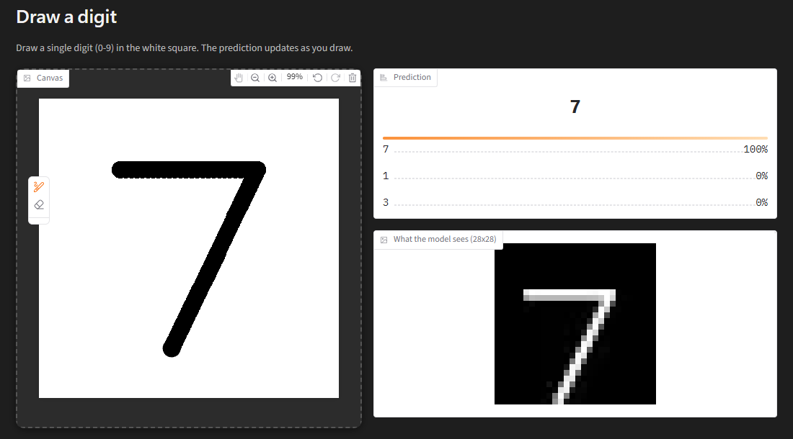

# MNIST Digit Recognizer

Draw a digit in your browser and a small neural network trained from scratch in PyTorch tells you what it is.



This was my first neural network project. I wrote the training code step by step while learning how networks learn. The process is kept in [`notebooks/learning_log.py`](notebooks/learning_log.py).

## Results

| | |
|---|---|
| Model | Fully connected network, 784 → 512 → 256 → 10 (ReLU), 535,818 parameters |
| Test accuracy | **97.86%** (test loss 0.0730) on the 10,000 MNIST test images |
| Training | Adam, lr 0.001, batch size 64, up to 20 epochs. The weights from the epoch with the lowest validation loss are kept (early stopping) |
| Data split | 54,000 train / 6,000 validation (fixed seed). The test set is used once, at the end |

## Run it

```bash
python -m venv .venv
# Windows: .venv\Scripts\activate    macOS/Linux: source .venv/bin/activate
pip install -r requirements.txt

python app.py      # opens the drawing app at http://127.0.0.1:7860
```

The trained weights (`mnist_mlp.pt`) are included, so the app works right away. To retrain from scratch, run `python train.py`. It downloads MNIST to `data/` and overwrites `mnist_mlp.pt` with the best epoch.

## How it works

| File | What it does |
|---|---|
| [`model.py`](model.py) | `build_model()`, the network architecture, shared by training and the app |
| [`train.py`](train.py) | Loads and normalizes MNIST, splits off a validation set, trains, saves the best epoch, and evaluates on the test set once |
| [`preprocess.py`](preprocess.py) | Turns a canvas drawing into an MNIST-style 28×28 input |
| [`app.py`](app.py) | Gradio UI: drawing canvas, top-3 predictions, and a "what the model sees" preview |

### Making drawings look like MNIST

The model scored about 97% on the test set but did noticeably worse on my own drawings. The cause was not the model. Canvas drawings reach it in a different form from the data it was trained on. `preprocess.py` reproduces how the MNIST images were prepared:

1. Invert colours, from black ink on white to white ink on black.
2. Crop to the ink's bounding box.
3. Scale so the longer side is 20 px, keeping the aspect ratio.
4. Place it in a 28×28 frame so that the **centre of mass** of the ink sits at the centre.
5. Scale to 0–1 and normalize with the training set's mean and std (0.1307, 0.3081).

Step 4 mattered most. Centring by bounding box instead of centre of mass dropped accuracy on re-drawn MNIST digits from 96.5% to 87.5%. 7s were hit hardest: they're top-heavy, so MNIST shifted them down in the frame. A fully connected network has no notion of neighbouring pixels, so a 2-pixel shift looks like a different input to it.

## Experiments

Run while learning, on a 784 → 128 → 10 baseline (97.3% validation accuracy):

| Experiment | Result | Takeaway |
|---|---|---|
| 1024 hidden units, 50 epochs | Validation loss bottomed out around epoch 5–10, then rose. Training loss fell to 0.008 | Overfitting. Validation accuracy still rose (98.1%) while validation loss got worse, because the model became overconfident on its mistakes |
| 16 hidden units | 93.8% (12,730 params, ~51 KB) | A big accuracy loss for an 8× smaller model |
| 16 → 16 and 16 → 16 → 16 | 94.4% and 95.3% | Extra small layers help, and cost almost no memory |
| Learning rate 1.0 / 0.01 / 0.0001 | Random guessing (loss ≈ ln 10) / jagged curves, 94.8% / smooth but slow, 96.1% | 0.001 was the best of the four |

## What I learned

- Train / validation / test splits, and why the test set is only touched once
- Normalization, using statistics from the training data only
- The training loop: forward pass, loss, backprop, optimizer step
- Reading loss curves: underfitting, overfitting, early stopping
- Trade-offs between model size, memory and accuracy (this project is step 1 toward a tiny network running on an ESP32)
- Data reaching a deployed model must be prepared exactly like its training data
